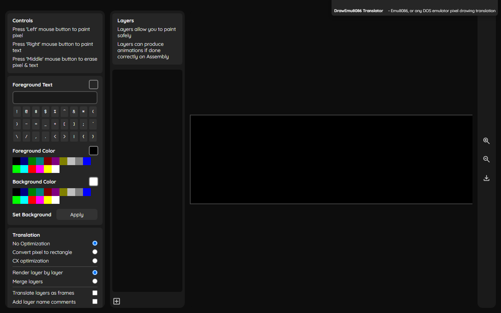

# DrawEmu8086

Draw pixel art and text in the browser, then export it as 8086 assembly that runs in Emu8086 or any DOS emulator.

## Features

- An 80 × 25 canvas that matches DOS text mode, with the 16-color palette.
- Left click paints a pixel, right click types the selected character, middle click erases.
- Layers you can rename, reorder, hide and delete.
- Exports a `DrawEmu8086.asm` file, with options to:
  - shorten the code by merging same-colored runs into one write (using a `CX` repeat count) or into rectangles;
  - merge all layers into one picture, or play each layer as an animation frame;
  - add layer-name comments and setup code.

## How the output works

The generated program switches to 80 × 25 text mode (`INT 10h`, `AH=00h`), moves the cursor (`AH=02h`) and writes each cell with its colors (`AH=09h`). Animation frames are separated by a screen clear (`AH=06h`).

## Run it

There's no build step. Open `index.html` in a browser, draw, choose your translation options and download the `.asm` file. Open it in Emu8086 and run it.

## Built with

JavaScript, HTML and CSS.
